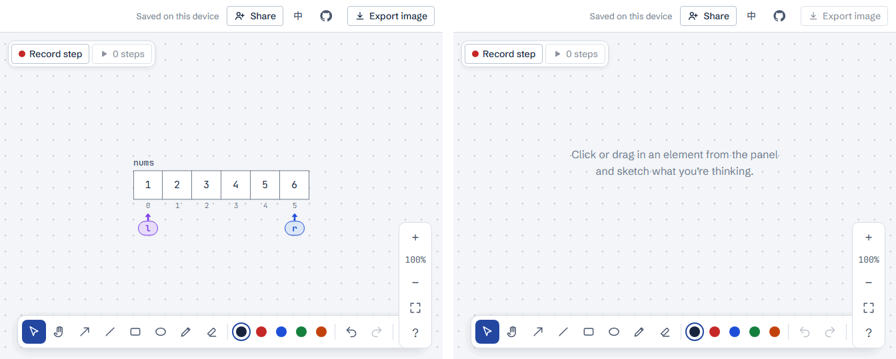
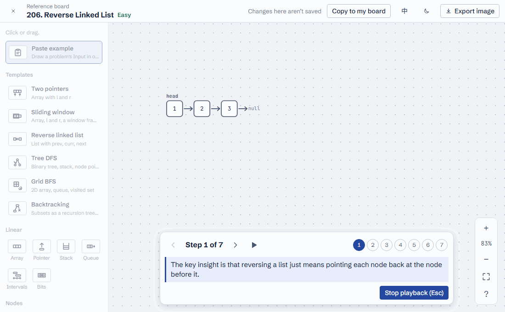

# DSA Whiteboard

[](https://www.npmjs.com/package/dsa-whiteboard) [](https://github.com/Lego514/dsa-whiteboard/actions/workflows/ci.yml) [](LICENSE)

A whiteboard for tracing data structures and algorithms by hand, with step-by-step playback and live co-editing. It's a React component on npm, and a site you can use right now.

**[Open the whiteboard](https://dsaboard.legoli.dev/)** (no sign-up, saved in your browser) · Examples: [206. Reverse Linked List](https://dsaboard.legoli.dev/#example=206), [1143. Longest Common Subsequence](https://dsaboard.legoli.dev/#example=1143), [200. Number of Islands](https://dsaboard.legoli.dev/#example=200)



*Two people on one board. Left: Alice. Right: Bob, who opened Alice's link.*

- **Elements that behave like the real thing.** 20+ elements, from arrays and pointers to trees, graphs, heaps, Union-Find, tries, DP tables, and intervals. A linked list's links reverse one at a time, a heap sifts values into place, Union-Find compresses paths, and a DP table draws arrows from the cells it depends on.
- **Paste a LeetCode example.** `nums = [2,7,11,15], target = 9` becomes an array and a variable; `root = [3,9,20,null,null,15,7]` becomes a tree.
- **Step-by-step playback.** Record the board as steps with a caption each, then play them back; elements slide from one step to the next. Code boxes can be traced line by line.
- **Live co-editing.** Share a link and up to 8 people edit together with their cursors on the canvas. A second, view-only link lets someone watch, such as an interviewer in a mock interview.
- **Export and themes.** Save a PNG of the board or the current step. English and Traditional Chinese, light and dark.

<picture><source media="(prefers-color-scheme: dark)" srcset="docs/images/reference-board-dark.gif"></picture>

*A recorded walkthrough playing back, from [LeetCode Coach](https://github.com/Lego514/leetcode-coach), which uses this package for its 213 reference boards.*

Every element and tool is described in [docs/elements.md](docs/elements.md).

## Use it in a React app

```bash
npm install dsa-whiteboard
```

React 19.2 or later is a peer dependency. zod 4 is needed only if you import `dsa-whiteboard/schema`.

```tsx
import { Whiteboard, type BoardDoc } from 'dsa-whiteboard';
import 'dsa-whiteboard/base.css'; // design tokens, buttons, inputs, dialog; skip if your app has its own
import 'dsa-whiteboard/board.css';

export function MyBoard({ initial, save }: { initial?: BoardDoc; save: (doc: BoardDoc) => Promise<void> }) {
  return <Whiteboard title="Two Sum" initial={initial} onSave={save} locale="en" onClose={() => history.back()} />;
}
```

The board takes the whole screen, and you own the storage:

| Prop | What it does |
| --- | --- |
| `initial` | The board to start from. Change the React `key` to load a different board. |
| `onSave(doc)` | Called about 0.6 s after the last change, and once more on close if something is unsaved. |
| `locale` | `'en'` or `'zh-TW'`. |
| `collab` | Joins a live room on the collab server. |
| `readOnlySteps`, `startAtStep`, `autoPlay` | For ready-made walkthroughs that open playing. |

Every prop, the share controls, and the schema export for servers are in [docs/react.md](docs/react.md).

## How it's built

- **No drawing library.** Elements are plain React (HTML, with SVG for edges, arrows, and ink) in one layer that pans and zooms with a CSS transform, and exported images are redrawn from the board's data as SVG. The board model and every edit, layout, and parser live in `src/lib/` as plain functions with no React, which is where most of the unit tests are.
- **One Durable Object per room.** The collab server is a Cloudflare Worker (`worker/`). Each room runs in its own Durable Object, so its messages are handled one at a time without locks. Clients send the new version of each element they touched; the room checks it with zod, applies changes in the order they arrive, and passes them on, so when two people change the same element at once, everyone ends up with the later one. A room is saved 2 seconds after a change and deleted 7 days after the last person leaves, and idle rooms hibernate, so it fits Cloudflare's free plan.
- **View-only links are derived, not stored.** The view code is a SHA-256 hash of the room id. The Durable Object is named after it, so both links reach the same room, and whether a connection can edit depends only on the path it came in on (`/room/` or `/view/`). The view link can't be turned back into the edit link.
- **Published from CI.** Each GitHub release is published to npm by GitHub Actions with provenance. CI type-checks a consumer of the published types under both `nodenext` and `bundler` resolution, and runs the Playwright tests on Chromium and iPhone WebKit against a local collab server.

## Run your own collab server

1. Create a Cloudflare account and an API token with the "Edit Cloudflare Workers" template.
2. Add the repository secrets `CLOUDFLARE_API_TOKEN` and `CLOUDFLARE_ACCOUNT_ID`. The "Deploy collab server" workflow then deploys on every push to `main` that changes the server (or run it by hand). Without the secrets it skips itself.
3. Set the repository variable `COLLAB_URL` to the Worker's address (such as `https://dsa-whiteboard-collab.<you>.workers.dev`) so the site build shows Share. Only pages from the origins in `ALLOWED_ORIGINS` (`wrangler.jsonc`) can connect.

## Develop

```bash
npm install
npm run dev          # the standalone site at http://localhost:5180
npm test             # unit tests (Vitest)
npm run test:e2e     # build the site, then run the Playwright tests (Chromium and iPhone WebKit) against a local collab server
npm run worker:dev   # the collab server at http://localhost:8787, no Cloudflare account needed
npm run media        # rebuild, then regenerate the screenshot and co-editing GIF in docs/images/
npm run lint
npm run typecheck
npm run build        # the package (dist/) and the site (dist-app/)
npm run check:types  # compile a consumer against the built types (after build)
```

The first time, run `npx playwright install chromium webkit`. To try co-editing locally, run `npm run worker:dev`, start the site with `VITE_COLLAB_URL=http://localhost:8787` in `.env.local`, and open the shared link in a second browser profile.

- `src/lib/`: the board model and every edit, layout, Build from text parsers, templates, Python highlighting, and SVG export
- `src/components/`: the editor (`Whiteboard.tsx`), element views, and the steps and playback bar
- `src/schema.ts`: the board format; `src/i18n/`: interface text in both languages; `src/styles/`: `board.css` and `base.css`
- `src/collab/`: co-editing in the browser: messages, turning edits into changes and back, and the connection with its retries
- `worker/`: the collab server; `app/`: the standalone site

## License

[MIT](LICENSE)
