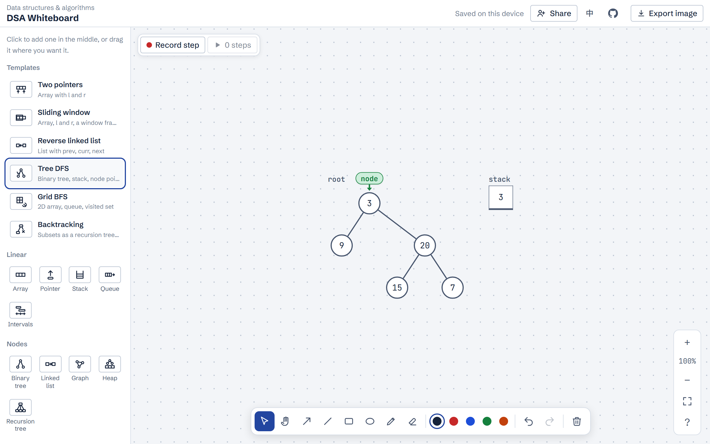
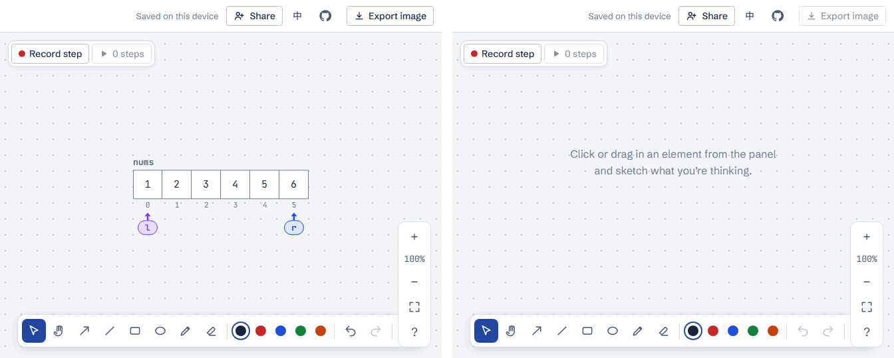

# DSA Whiteboard

A whiteboard for data structures and algorithms, built from scratch in React and TypeScript.

**Try it:** https://lego514.github.io/dsa-whiteboard/ (no sign-up; the board is saved in your browser). Press **Share** to get a link: everyone who opens it edits the same board live, with each person's cursor and name on the canvas.

<picture><source media="(prefers-color-scheme: dark)" srcset="docs/images/board-dark.png"></picture>

Drag arrays, pointers, stacks, queues, dicts, sets, 2D arrays, variables, binary trees, linked lists, graphs, heaps, recursion trees, Union-Find, tries, bits, DP tables, intervals, tables, text, code, and sticky notes onto a pannable, zoomable canvas to trace an idea by hand.

Built for working through LeetCode-style problems by hand: sliding windows, linked list reversal, tree and graph traversals, heaps, backtracking, Union-Find, tries, bit manipulation, DP tables, and intervals. It started as the whiteboard in [LeetCode Coach](https://github.com/Lego514/leetcode-coach), which still uses it as a package.

## Features

- **Range frames** box the cells between two pointers on the same array and follow them as they move, for sliding windows: select the two pointers and choose "Frame between pointers".
- **Templates** set up a common scene in one click, with the pointers already named: two pointers, sliding window, reversing a linked list, tree DFS, grid BFS, and backtracking (the subsets decision tree with `path` and a `cur` pointer). The whole group is placed in free space and selected so it can be dragged at once.
- The palette is grouped by how often problems use each element, with line icons. Text switches to a heading from the selection bar.
- **Pointers** snap to array cells, step with the arrow keys, and are colored by name (i, j, k, l).
- **Single cells** can be selected one at a time to highlight them, put a pointer on them, insert next to them, or delete them. Pointers and highlights follow their values when cells move. A dashed "+" adds cells, rows, and columns.
- **Linked lists** are one element:
  - Each link between two nodes cycles between forward, reversed, and cut with a click, so reversing a list can be traced link by link.
  - The tail can point back to any node to show a cycle.
  - Pointers such as prev, curr, and next snap under nodes.
- **Binary trees** lay themselves out in order, so a binary search tree reads sorted from left to right.
  - Pick a node to add a left or right child from a dashed slot, color it, or delete its subtree.
  - Pointers sit above nodes and move to a child or the parent with the arrow keys.
  - Up to six levels.
- **Graphs** lay their nodes out on a circle.
  - Directed graphs get arrowheads, and opposite edges between the same two nodes curve apart.
  - Edges can carry weights and be marked as visited.
  - Pick a node to connect it to another, color it, add a pointer, or delete it. Pick an edge to mark it, weigh it, or delete it.
  - Up to 20 nodes and 60 edges.
- **Heaps** draw the same values as a tree and as an array with indices, or either one alone.
  - Push and Pop sift values into place by the heap rules; "Record each step for playback" saves every swap as a step, captioned like `swap 0 ↔ 2`.
  - Switch between a min-heap and a max-heap. Nodes that break the order turn red, and Heapify fixes them all at once.
  - Values compare as numbers when they are numbers. Up to 31 values (five levels).
- **Recursion trees** draw one node per call, laid out top-down so each caller sits over its calls, for backtracking and memoized DP.
  - Pick a call to add a child call, write its return value or the choice on the edge above it, or prune the branch (drawn dashed and faded).
  - "Color repeated calls" gives calls with the same label the same color, which shows what memoization would save.
  - A pointer steps through the calls in DFS order with ← →, and back to the caller with ↑, so a trace can be recorded step by step.
  - Up to 63 calls and eight levels.
- **DP tables** fill one cell at a time, 1D (`dp[i]`) or 2D (`dp[i][j]`), with the strings or numbers from the problem written beside the rows and columns.
  - Choose what each cell depends on (`dp[i-1], dp[i-2]`, every earlier `dp[j]`, `dp[i-k]` for coins, up/left/diagonal, or `dp[i+1][j-1]` filled from the bottom row for palindromes). The cell being filled then shows arrows from those cells, as arcs under a 1D table.
  - Type the value in the selection bar and press Enter to move to the next empty cell. With "Record each filled cell" on, every cell becomes a playback step captioned like `dp[2][3] = 2`, so the whole fill order can be replayed.
  - Up to 26 rows and 30 columns.
- **Intervals** sit on one number line with round ticks, one row per interval, so overlaps line up, for Merge Intervals, Insert Interval, Meeting Rooms, and the like.
  - "Sort by start" is the first step of merging. Pick an interval to change its start or end, merge it with the next row when they overlap (touching ends count), mark it removed (dashed), or color it.
  - The sweep line stops at each start and end point and shows how many intervals are in progress there, counting starts but not ends, so its peak is the answer to Meeting Rooms II.
  - Up to 30 intervals.
- **Union-Find** draws the parent array and the forest it describes: one tree per set, arrows from each node to its parent, and a loop on each root. Merged sets share a color, and the name shows how many sets there are.
  - Pick a node to Find it (with path compression) or Union it with another node. The nodes a find walks through are outlined, and "Record each step for playback" saves the walk, the compression, and the merge as separate steps.
  - Union by rank adds a rank row and puts the shorter tree under the taller one.
  - Up to 20 nodes.
- **Tries** grow from the words put into them, children in alphabetical order, with a green ring on letters that end a word.
  - Insert walks the shared prefix first, then adds the rest. Search follows the letters as far as they go and says found, prefix only, or not found. Both can be recorded letter by letter.
  - Pick a node to search its prefix or remove its word. Up to 30 words of 16 letters.
- **Bits** draw a number as a row of 0s and 1s, with bit positions below and the decimal value and count of 1s beside the name.
  - Click a bit to flip it. Shift left or right, clear the lowest 1 with `n & (n-1)`, or type a new number. Up to 32 bits.
- **Code boxes** look and type like LeetCode's editor: a `Python3` header, line numbers, and Python colors in VS Code's light and dark themes, with no wrapping and the box sized to the code. New boxes start from a `class Solution:` template.
  - While editing, the colors stay on screen: a transparent text box sits exactly over the highlighted code. Tab and Shift+Tab indent and outdent, Enter keeps the indentation (one more level after a colon), and Backspace in the indentation removes a level.
- **Code tracing** turns a code box into a dry run, the Test step of an interview.
  - "Trace line by line" highlights the line running. Move with ↑ ↓ or by clicking a line; blank lines are skipped.
  - With "Record each line" on, every move first saves the board as a step with the line that just ran highlighted. Update the variables and arrays beside it as you go, and playback replays the whole run, with room for a one-line note per step.
- **Paste example** (top of the palette) draws a problem's whole Input at once: `nums = [2,7,11,15], target = 9` becomes an array and a variable, selected together so the group can be dragged into place.
  - Copying the example straight from LeetCode works, `Input:` and `Output:` included.
  - Names decide the shape: `root` is a tree, `head` or `l1` a linked list, `edges` or `prerequisites` with `n` or `numCourses` a graph (directed for prerequisites), `intervals` with an optional `newInterval` a number line, other 2D arrays a grid, and objects a dict.
  - Strings are split into characters, and numbers and booleans become variables.
- **Build from text**: arrays, stacks, queues, heaps, sets, dicts, 2D arrays, linked lists, trees, graphs, recursion trees, Union-Find, tries, bits, DP tables, and intervals can all be filled by pasting a problem's example instead of typing cell by cell:
  - `nums = [2,7,11,15], target = 9` takes the first value and renames the element `nums`
  - `"abcabcbb"` splits into characters
  - `{'a': 1}` or JSON for dicts, and `[[1,0],[0,1]]` for grids
  - `1->2->3` and `head = [...]` for linked lists, and LeetCode's level order `[3,9,20,null,null,15,7]` for trees
  - `n = 5, edges = [[0,1],[0,2]]` (with optional weights) or an adjacency list (0- or 1-based) for graphs
  - an indented outline for recursion trees, one call per line, such as `f(3) => 2` with `n-1 | f(2)` underneath (`|` puts a label on the edge, `=>` adds a return value); the output of the `tree` command also works
  - the problem's own input for DP tables: `text1 = "abcde", text2 = "ace"` makes a 6×4 table with the letters beside it, `m = 3, n = 7` a 3×7 grid, `n = 5` six cells, `coins = [1,2,5], amount = 11` twelve cells that look back 1, 2, and 5, and `s = "226"` or `nums = [...]` a row labeled with the characters or numbers
  - `n = 5, edges = [[0,1],[1,2]]` (merged in order) or `parent = [0,0,1]` for Union-Find, `["apple","app"]` for tries, and `n = 11`, `0b1011`, or LeetCode's 32-character bit strings for bits
  - `intervals = [[1,3],[2,6]]` for intervals; a `newInterval = [4,8]` is added in yellow, and an employee `schedule` gets one color per person
- **Other tools**:
  - rectangle and ellipse frames, which draw on top but stay click-through except their outline
  - arrows and plain lines (for undirected edges) that follow the elements they connect
  - a pen, an eraser, and five colors
  - undo/redo and clear canvas
- **Box selection**: drag across empty space to select everything inside, then move, duplicate, delete, or recolor it together. Copies keep pointers on their copied arrays and rewire arrows to the copied elements.
- **Step playback**: "Record step" saves a snapshot of the board with an optional one-line note (writing it in English doubles as explanation practice). Playback steps through the snapshots with the arrow keys or plays them automatically; elements slide from one step to the next. You can continue editing from any step.
- **Export image**: the board, or the step being played, is redrawn from its data as an SVG and saved as a 2× PNG.
- **Live co-editing**: Share turns your board into a room at a link like `…/#room=k3f9x2…`. Up to 8 people edit it together and see each other's cursors. Undo only takes back your own changes. Edits made while offline are sent when the connection comes back. Your own board stays as it was; "Save a copy to my board" keeps the shared one. Rooms are kept for 7 days after the last person leaves.

  

  *Left: Alice. Right: Bob, who opened Alice's link.*

The interface is in English and Traditional Chinese.

## Use it in a React app

The package isn't on npm yet. Install it from GitHub at a release tag:

```bash
npm install github:Lego514/dsa-whiteboard#v0.1.6
```

React 19.2 or later is a peer dependency. zod 4 is needed only if you import `dsa-whiteboard/schema`.

```tsx
import { Whiteboard, type BoardDoc } from 'dsa-whiteboard';
import 'dsa-whiteboard/base.css'; // design tokens, buttons, inputs, dialog; skip if your app has its own
import 'dsa-whiteboard/board.css';

export function MyBoard({ initial, save }: { initial?: BoardDoc; save: (doc: BoardDoc) => Promise<void> }) {
  return <Whiteboard title="Two Sum" initial={initial} onSave={save} locale="en" onClose={() => history.back()} />;
}
```

The board takes the whole screen. You own the storage: `onSave` is called about 0.6 s after the last change, and once more on close if something is unsaved.

| Prop | What it does |
| --- | --- |
| `initial` | The board to start from. Change the React `key` to load a different board. |
| `onSave(doc)` | Saves the board; may return a promise. |
| `title`, `caption`, `badge` | The header. `badge` sits next to the title, for example a difficulty tag. |
| `actions` | Extra buttons or links in the header, before Export. |
| `savedLabel` | What the header says once saved, such as "Synced". Defaults to "Saved on this device". |
| `locale` | `'en'` or `'zh-TW'`. |
| `onClose` | Shows a Close button. |
| `exportName` | File name for exported PNGs. |
| `onNotice(message)` | Shows messages (such as a failed export) with your app's toasts instead of the board's own. |
| `onChange(doc)` | Called right away on every change (and once when the board opens), without waiting for the save delay. |
| `collab` | Joins a live room: `{ url, name, seed?, onStatus? }`. `url` is the room's WebSocket address on the collab server, `name` is shown next to your cursor, `seed` puts your board into the room if it's empty (for whoever creates it), and `onStatus` reports the connection and who's there. While in a room, the room's board is the one shown. |
| `explain` | Adds an Explain button that plays the recorded steps. You provide `Session` (shown under the playback bar while explaining) and `Review` (shown over the board when done). LeetCode Coach uses it for spoken explanations with a timer, recording, and transcript. |

Put `<ShareControls>` in `actions` for the share UI: a Share button outside a room, and inside one the people's avatars (click for who's here, change your name, save a copy, leave) plus Copy link. You decide where the room id lives: `onShare()` creates the room and returns its link (copied for you), and `link`, `onRename(name)`, `onSaveCopy()`, `onLeave()` handle the rest. While in a room, the header shows the connection status instead of `savedLabel`.

`newRoomId()` makes a random room id and `ROOM_ID` checks one; `PEER_COLORS` lists the colors people get, and `[data-peer="blue"]` (and so on) sets `--peer` to that color for your own avatars.

`dsa-whiteboard/schema` exports the zod schema for a board (`boardDocSchema`), its types, and the size limit, without React, so a server can validate boards before storing them.

## Collab server

Rooms run on a Cloudflare Worker with one Durable Object per room (`worker/`), which fits Cloudflare's free plan. Each change is sent as the new version of the elements it touched; the server applies them in the order they arrive and passes them on, so when two people change the same element at once, everyone ends up with the later one. The room's board is saved 2 seconds after a change and deleted 7 days after the last person leaves. Only pages from the origins in `ALLOWED_ORIGINS` (`wrangler.jsonc`) can connect.

To deploy your own:

1. Create a Cloudflare account and an API token with the "Edit Cloudflare Workers" template.
2. Add the repository secrets `CLOUDFLARE_API_TOKEN` and `CLOUDFLARE_ACCOUNT_ID`. The "Deploy collab server" workflow then deploys on every push to `main` that changes the server (or run it by hand). Without the secrets it skips itself.
3. Set the repository variable `COLLAB_URL` to the Worker's address (such as `https://dsa-whiteboard-collab.<you>.workers.dev`) so the site build shows Share. Locally, put `VITE_COLLAB_URL=…` in `.env.local`.

## Develop

```bash
npm install
npm run dev          # the standalone site at http://localhost:5180
npm test             # unit tests (Vitest)
npm run test:e2e     # build the site, then run the Playwright tests (Chromium and iPhone WebKit) against a local collab server
npm run worker:dev   # the collab server at http://localhost:8787, no Cloudflare account needed
npm run media        # rebuild, then regenerate the README screenshot and co-editing GIF in docs/images/
npm run lint
npm run typecheck
npm run build        # the package (dist/) and the site (dist-app/)
```

The first time, run `npx playwright install chromium webkit`.

- `src/lib/`: pure logic with no React: the board model and every edit, layout, Build from text parsers, templates, Python highlighting and editing rules, and SVG export. Most of the unit tests are here.
- `src/components/`: the editor (`Whiteboard.tsx`), element views, and the steps and playback bar.
- `src/schema.ts`: the board format.
- `src/i18n/`: interface text in both languages.
- `src/styles/`: `board.css` for the board, `base.css` for apps without their own styles.
- `src/collab/`: live co-editing in the browser: the messages, turning edits into changes and back, and the connection with its retries.
- `worker/`: the collab server (Cloudflare Worker and Durable Object).
- `app/`: the standalone site deployed to GitHub Pages.

To try co-editing locally, run `npm run worker:dev` and start the site with `VITE_COLLAB_URL=http://localhost:8787` in `.env.local`, then open the shared link in a second browser profile.

## License

MIT
